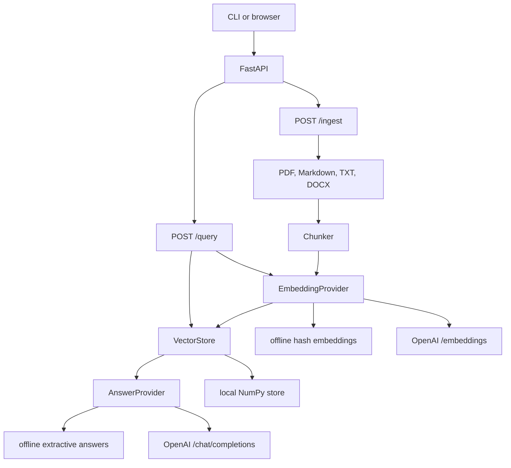

# RAG Knowledge Base

[](https://github.com/maikama8/rag-knowledge-base/actions/workflows/ci.yml)

A knowledge base is only useful if an answer can be checked. This service indexes PDF, Markdown, text, and DOCX files, then answers a question from those files. Every claim in the answer cites the source file and the chunk or page it came from.

It is a portfolio project: a small FastAPI application with provider boundaries around embeddings, the language model, and the vector store. The default providers run entirely offline, so the API, the tests, the CLI, and Docker start with no API keys. An OpenAI-compatible embeddings endpoint and chat model are wired in behind the same interfaces and selected with environment variables.

## Features

- `POST /ingest` indexes PDF, Markdown, TXT, and DOCX uploads. Uploading the same file name replaces that document.
- `POST /documents` indexes a raw Markdown or text body.
- `POST /query` answers from the index. Each claim carries a citation with the source file, chunk number, and PDF page when the file has pages.
- `GET /documents` and `DELETE /documents/{document_id}` list and remove indexed files.
- Embeddings and the answer model sit behind provider interfaces. `offline` is the default. `openai` calls an OpenAI-compatible API.
- The vector store sits behind a `VectorStore` interface. The default `local` store is a NumPy cosine index on disk.
- A browser UI at `/ui` and a CLI (`python -m app.cli`) for ingest and questions.
- Interactive OpenAPI docs at `/docs`, a `/health` probe, and a configurable upload limit.

The offline embedder is a hashing bag-of-words model. Passages that share words with the question rank higher. The offline answerer quotes sentences from those passages. It does not paraphrase. It is deterministic and good enough to demo the contract. It is not a substitute for the OpenAI providers on questions that need a summary rather than a sentence from the source.

## Tech stack

- Python 3.11+
- [FastAPI](https://fastapi.tiangolo.com/) and [Pydantic Settings](https://docs.pydantic.dev/latest/concepts/pydantic_settings/)
- [Uvicorn](https://www.uvicorn.org/)
- [NumPy](https://numpy.org/) for the local cosine store
- [pypdf](https://pypdf.readthedocs.io/) and [python-docx](https://python-docx.readthedocs.io/)
- [HTTPX](https://www.python-httpx.org/) for the OpenAI-compatible REST calls
- [pytest](https://docs.pytest.org/) and [Ruff](https://docs.astral.sh/ruff/)
- Docker

## Architecture



`app/main.py` builds one embedding provider, one vector store, and one answer provider from the environment when the process starts. Routes depend on that knowledge base, so tests can replace a provider without touching the network. `app/services/pipeline.py` is the only place that chains load, chunk, embed, retrieve, and answer.

Citations are assembled in `app/services/citations.py`. The displayed `answer` is built from the claim list, and a claim with no citation is rejected. An empty claim list is a refusal: the text says the index did not contain an answer, and `claims` and `citations` are both empty.

| `EMBEDDING_PROVIDER` | Behavior |
| --- | --- |
| `offline` (default) | Hashes content words into a fixed vector. No download and no API key. Similar wording ranks higher. |
| `openai` | `POST {OPENAI_BASE_URL}/embeddings` with `OPENAI_EMBEDDING_MODEL` (default `text-embedding-3-small`). Requires `OPENAI_API_KEY`. |

| `LLM_PROVIDER` | Behavior |
| --- | --- |
| `offline` (default) | Quotes retrieved sentences that share at least half of the question's content words. Each sentence is one claim, cited to its chunk. |
| `openai` | Chat completion at `{OPENAI_BASE_URL}/chat/completions` using `OPENAI_CHAT_MODEL` (default `gpt-4o-mini`). The model must return JSON claims that name chunk ids from the retrieved passages. Claims that cite an unknown id are dropped, then the answer is rebuilt so every remaining claim has a marker. Requires `OPENAI_API_KEY`. |

| `VECTOR_STORE` | Behavior |
| --- | --- |
| `local` (default) | L2-normalized vectors and cosine similarity in NumPy. Writes `index.json` and `vectors.npy` under `DATA_DIR`. Refuses to load an index built by a different embedding provider or dimension. |

Choosing `openai` without a key stops the process at startup with a clear error.

Markdown is split on headings before size-based chunking, so a short section stays one chunk and can be cited on its own. PDF text is chunked per page, so a citation can name that page. Overlap applies only when a single paragraph is longer than `CHUNK_SIZE`.

## Getting started

### Local

```bash
git clone https://github.com/maikama8/rag-knowledge-base.git
cd rag-knowledge-base
python -m venv .venv
source .venv/bin/activate  # Windows: .venv\Scripts\activate
pip install -r requirements.txt
cp .env.example .env
uvicorn app.main:app --reload --host 127.0.0.1 --port 8000
```

- API: `http://127.0.0.1:8000`
- Docs: `http://127.0.0.1:8000/docs`
- Health: `http://127.0.0.1:8000/health`
- Browser UI: `http://127.0.0.1:8000/ui`

Install `requirements-dev.txt` instead when you also want pytest and Ruff. `make dev`, `make test`, and `make run` wrap the same commands.

The CLI uses the same index as the API:

```bash
python -m app.cli ingest examples/handbook.md
python -m app.cli query "How long is the refund window?"
python -m app.cli documents
```

### Docker

```bash
docker compose up --build
```

The image listens on port 8000 and defaults to the offline providers. The index is stored in the `rag-data` volume at `/data`. Compose reads provider settings from your shell or a `.env` file in this directory. An empty `.env` copied from `.env.example` is enough.

Run a single worker. The local index is a pair of files owned by this process.

### Configuration

Settings are loaded from the environment and from a `.env` file in the working directory. Names are case-insensitive. See `.env.example` for the full list.

| Variable | Default | Purpose |
| --- | --- | --- |
| `EMBEDDING_PROVIDER` | `offline` | `offline` or `openai` |
| `LLM_PROVIDER` | `offline` | `offline` or `openai` |
| `VECTOR_STORE` | `local` | `local` NumPy store |
| `DATA_DIR` | `./data` | Where `index.json` and `vectors.npy` are written |
| `CHUNK_SIZE` | `800` | Maximum characters in a packed chunk |
| `CHUNK_OVERLAP` | `120` | Characters repeated when a paragraph is split. Must be smaller than `CHUNK_SIZE` |
| `TOP_K` | `4` | Chunks retrieved before the score floor |
| `MIN_SCORE` | `0.15` | Cosine similarity required to use a chunk |
| `OFFLINE_EMBEDDING_DIMENSIONS` | `512` | Width of the hashing embedder |
| `OPENAI_API_KEY` | empty | Required when either provider is `openai` |
| `OPENAI_BASE_URL` | `https://api.openai.com/v1` | API root, including compatible gateways |
| `OPENAI_EMBEDDING_MODEL` | `text-embedding-3-small` | Embeddings model |
| `OPENAI_EMBEDDING_DIMENSIONS` | `1536` | Sent as `dimensions` and stored with the index |
| `OPENAI_CHAT_MODEL` | `gpt-4o-mini` | Chat model |
| `OPENAI_TIMEOUT_SECONDS` | `60` | HTTP timeout |
| `MAX_UPLOAD_BYTES` | `26214400` | Upload limit, 25 MiB |

Switching embedding provider or dimension against an existing `DATA_DIR` fails at startup. Delete that directory, or point `DATA_DIR` somewhere new, then ingest again.

## API

### `GET /health`

```bash
curl -s http://127.0.0.1:8000/health
```

```json
{
  "status": "ok",
  "embedding_provider": "offline",
  "llm_provider": "offline",
  "vector_store": "local",
  "documents": 0,
  "chunks": 0
}
```

`GET /` returns the same provider names plus the service version and links to `/docs` and `/ui`.

### `POST /ingest`

Multipart form, field name `files`. One request can carry several files. PDF, `.md`, `.markdown`, `.txt`, and `.docx` are accepted.

```bash
curl -s -X POST http://127.0.0.1:8000/ingest \
  -F "files=@examples/handbook.md"
```

```json
{
  "documents": [
    {
      "document_id": "a0a1ca15ef93a328",
      "source": "handbook.md",
      "chunks": 4,
      "pages": null
    }
  ],
  "embedding_provider": "offline",
  "vector_store": "local"
}
```

`pages` is the PDF page count. It is `null` for Markdown, text, and DOCX. `document_id` is derived from the file name, so a later upload of `handbook.md` replaces the previous chunks.

`POST /documents` accepts JSON instead of a file:

```bash
curl -s -X POST http://127.0.0.1:8000/documents \
  -H 'Content-Type: application/json' \
  -d '{"filename":"notes.md","text":"The refund window is 30 days from the purchase date."}'
```

### `POST /query`

JSON body: `question` (required) and optional `top_k` from 1 to 20.

```bash
curl -s -X POST http://127.0.0.1:8000/query \
  -H 'Content-Type: application/json' \
  -d '{"question":"How long is the refund window?"}'
```

Against [`examples/handbook.md`](examples/handbook.md), the offline providers return [`examples/sample_query.json`](examples/sample_query.json):

```json
{
  "question": "How long is the refund window?",
  "answer": "The refund window is 30 days from the purchase date. [1]",
  "claims": [
    {
      "text": "The refund window is 30 days from the purchase date.",
      "citations": [
        {
          "source": "handbook.md",
          "chunk_id": "a0a1ca15ef93a328:1",
          "chunk_index": 1,
          "page": null,
          "score": 0.343,
          "excerpt": "The refund window is 30 days from the purchase date. Refunds go back to the original payment method.",
          "label": "handbook.md, chunk 2"
        }
      ]
    }
  ],
  "citations": [
    {
      "source": "handbook.md",
      "chunk_id": "a0a1ca15ef93a328:1",
      "chunk_index": 1,
      "page": null,
      "score": 0.343,
      "excerpt": "The refund window is 30 days from the purchase date. Refunds go back to the original payment method.",
      "label": "handbook.md, chunk 2"
    }
  ],
  "provider": "offline",
  "refused": false
}
```

`label` is the locator to show a person: `handbook.md, chunk 2`, or `policy.pdf, page 2, chunk 2` when the source is a PDF. Chunk numbers in `label` start at 1. `chunk_index` in the JSON starts at 0. `tests/test_examples.py` fails if `sample_query.json` drifts from a live `POST /query` of the handbook.

A question the index cannot support returns no claims:

```json
{
  "question": "What is the office wifi password?",
  "answer": "I could not find this in the knowledge base.",
  "claims": [],
  "citations": [],
  "provider": "offline",
  "refused": true
}
```

### `GET /documents` and `DELETE /documents/{document_id}`

`GET /documents` lists `document_id`, `source`, and `chunks`. `DELETE` removes that file. An unknown id is `404`.

### Errors

| Status | When |
| --- | --- |
| 400 | Empty upload, unsupported type, unreadable PDF or DOCX, or a file with no extractable text |
| 404 | Delete of a document that is not in the index |
| 413 | Upload larger than `MAX_UPLOAD_BYTES` |
| 422 | Query or text body fails validation |
| 502 | The selected provider failed while calling a model or API |
| 503 | The selected provider is missing a key or dependency at request time |
| 500 | The on-disk index cannot be read |

## Project structure

```
rag-knowledge-base/
├── app/
│   ├── main.py                          # application factory
│   ├── config.py                        # pydantic-settings
│   ├── cli.py                           # ingest, query, documents, serve
│   ├── api/                             # routes, dependencies, error handlers
│   ├── schemas/knowledge.py             # request and response models
│   ├── static/index.html                # browser UI
│   └── services/
│       ├── factory.py                   # picks providers from settings
│       ├── pipeline.py                  # load, chunk, embed, retrieve, answer
│       ├── chunking.py
│       ├── citations.py                 # labels and the cited-answer builder
│       ├── documents/loaders.py         # PDF, Markdown, TXT, DOCX
│       ├── embeddings/                  # offline hash, OpenAI-compatible
│       ├── llm/                         # offline extractive, OpenAI chat
│       └── vectorstore/                 # VectorStore protocol, local NumPy store
├── examples/
│   ├── handbook.md
│   └── sample_query.json
├── tests/
├── Dockerfile
├── docker-compose.yml
├── Makefile
├── requirements.txt
├── requirements-dev.txt
├── pyproject.toml
└── .env.example
```

## Testing

```bash
pip install -r requirements-dev.txt
ruff check .
ruff format --check .
pytest
```

GitHub Actions (`.github/workflows/ci.yml`) runs those three commands on Python 3.12 for pushes to `main` and for pull requests.

The suite covers chunk boundaries and overlap, retrieval ranking, citation labels, the rule that every claim is cited, document readers, the HTTP contract, provider selection, and the OpenAI adapters with a fake HTTP client. No test calls the network.

## Roadmap

- A second vector store, such as Chroma or pgvector, behind the same `VectorStore` interface.
- Hybrid keyword and vector retrieval, then a reranker.
- Streaming answers.
- Collections, so more than one index can live in `DATA_DIR`.
- A small evaluation set with recall@k for the offline embedder and the OpenAI embedder.
- OCR for scanned PDFs.
- Auth in front of ingest and delete.

## Author

**Abdulrasheed Oseni** ([@maikama8](https://github.com/maikama8)), Zarachtech.

This repository is a public portfolio project.

## License

[MIT](LICENSE). Copyright (c) 2026 Abdulrasheed Oseni.
